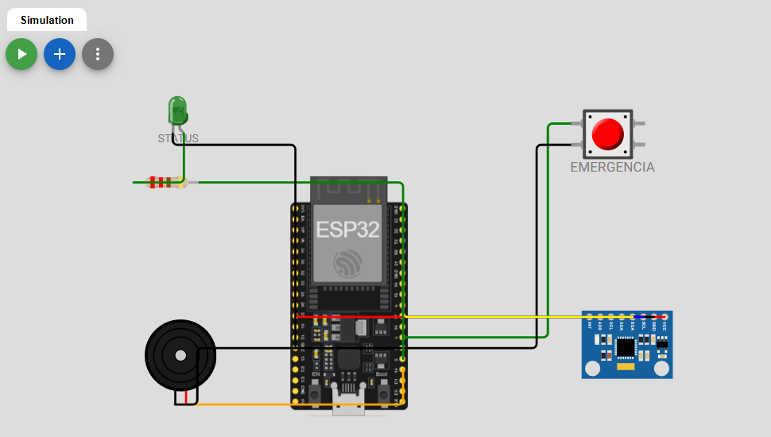
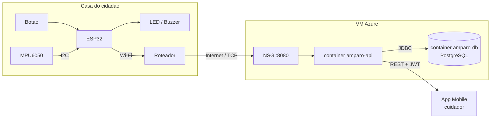

# Amparo · Dispositivo IoT de emergência

**Global Solution 2026/2 · CitizenTech · FIAP · Disruptive Architectures: IoT, IoB & Generative IA**

Dispositivo vestível para idosos e pessoas com deficiência que moram sozinhos. Um **botão de
emergência** e um **acelerômetro** (detecção de queda) em um ESP32 enviam o evento para a
API Amparo pela internet; a API aciona automaticamente o cuidador de prioridade 1 e, se ele
não responder, escala para o próximo.

- **Problema:** queda é a principal causa de internação de idosos no Brasil. Quem mora sozinho
  pode levar horas para conseguir pedir ajuda.
- **Cidadão beneficiado:** idosos e PcD que vivem sozinhos; famílias e cuidadores.
- **ODS:** 3 (Saúde e bem-estar) e 10 (Redução das desigualdades).

## Integrantes

| Nome | RM | Turma |
|------|----|-------|
| Matheus Carneiro Maciel | 567753 | 2TDSPB |
| Murilo Marques Cabral | 568224 | 2TDSPB |
| Paulo Henrique da Silva Kian | 563343 | 2TDSPB |

## Repositórios da solução

| Parte | Repositório |
|-------|-------------|
| API (Java / Spring Boot) | https://github.com/kakarneiro/amparo-api |
| Infra em nuvem (Docker + Azure) | https://github.com/kakarneiro/amparo-devops |
| Este dispositivo | https://github.com/kakarneiro/amparo-iot |

---

## 1. Funcionalidade

| Entrada | O que o ESP32 faz | O que a API faz |
|---------|-------------------|-----------------|
| Botão pressionado | Buzzer avisa, LED pisca, envia `BOTAO_EMERGENCIA` | Cria o evento, aciona o cuidador de prioridade 1 |
| Aceleração total > 2,5 g | Idem, envia `QUEDA_DETECTADA` com o valor medido | Idem |
| Dispositivo ligado | Envia `TESTE` | Registra, **não** aciona ninguém |
| Wi-Fi caiu | Reconecta sozinho antes de enviar | — |
| Dois impactos em < 10 s | Ignora o segundo (anti-repetição) | — |

O ESP32 **não conhece o cidadão**: ele envia só o próprio serial (`ESP32-0001`). A API resolve
dispositivo → cidadão → cadeia de cuidadores. Assim trocar o aparelho de pessoa é só
recadastrar na API.

## 2. Componentes

| Componente | Função | Pino ESP32 |
|------------|--------|-----------|
| ESP32 DevKit V4 | Processamento + Wi-Fi | — |
| Botão (push button) | Emergência manual | GPIO 4 (`INPUT_PULLUP`) |
| MPU6050 (GY-521) | Acelerômetro 3 eixos — detecção de queda | I2C: SDA 21, SCL 22, 3V3, GND |
| LED verde + resistor 220 Ω | Status (conectado / evento enviado / falha) | GPIO 2 |
| Buzzer | Feedback sonoro ao cidadão | GPIO 15 |

Escolhas:
- **ESP32** em vez de Arduino Uno: tem Wi-Fi integrado, e a solução só faz sentido conectada.
  É programado pela IDE Arduino, com as mesmas bibliotecas e o mesmo modelo de `setup/loop`.
- **MPU6050**: acelerômetro barato (~R$ 15), I2C, com biblioteca madura (Adafruit). A queda é
  detectada pela **magnitude da aceleração** (`√(x²+y²+z²)`): em repouso ≈ 1 g; um impacto
  passa de 2,5 g.
- **Botão como principal, queda como complementar**: o botão é determinístico e nunca falha na
  demo; a detecção de queda é a evolução natural e fica calibrável pelo limiar `LIMIAR_QUEDA_G`.

## 3. Circuito



*(exporte do Wokwi: menu ⋯ → "Download diagram as PNG" e salve em `docs/circuito-wokwi.png`)*

Protótipo virtual: **https://wokwi.com/projects/SEU_ID_AQUI** *(preencher)*

## 4. Comunicação em rede

### Dispositivos e componentes de rede

| Camada | Elemento | Papel |
|--------|----------|-------|
| Dispositivo | ESP32 (estação Wi-Fi, IP por DHCP) | Origem dos dados |
| Acesso | Roteador Wi-Fi 2,4 GHz da residência (802.11 b/g/n) | Conecta o ESP32 à LAN e faz NAT para a internet |
| Transporte | Internet (operadora) | Leva o pacote até a nuvem |
| Nuvem | VM Azure (IP público, NSG liberando TCP 8080) | Hospeda a API em container Docker |
| Aplicação | Container `amparo-api` (Spring Boot) + container `amparo-db` (PostgreSQL) na rede Docker interna | Processa a regra e persiste |
| Usuário | App Mobile (Flutter) | Cuidador recebe e responde |

### Protocolos

| Nível | Protocolo | Por quê |
|-------|-----------|---------|
| Enlace/rede | Wi-Fi 802.11 + IPv4 (DHCP) | Infra já existente na casa, sem custo extra |
| Transporte | TCP | Garantia de entrega: um evento de emergência não pode se perder |
| Aplicação | **HTTP/1.1 — `POST /eventos` com JSON** | A API já é REST; o ESP32 fala direto com ela sem broker intermediário. O corpo é o mesmo DTO que o app usa |
| Segurança | Header `X-Device-Token` | O dispositivo não faz login; um token fixo identifica dispositivos legítimos |

> Alternativa avaliada: **MQTT**. É o padrão IoT para telemetria contínua, mas aqui o
> dispositivo envia poucos eventos, cada um precisa de confirmação imediata (201) e a API REST
> já existe. HTTP direto elimina o broker e simplifica a demonstração. Se o produto evoluir para
> telemetria (batimentos, localização), MQTT com um broker na VM seria o próximo passo.

### Caminho dos dados

```
[Botão / MPU6050]
      │ GPIO / I2C
      ▼
   [ESP32] ── JSON {codigoSerial, tipo, descricao} + X-Device-Token
      │ Wi-Fi 2,4 GHz
      ▼
[Roteador residencial] ── NAT
      │ Internet (TCP/IP)
      ▼
[VM Azure :8080] ── NSG permite TCP 8080
      │ rede Docker (bridge)
      ▼
[container amparo-api] ── DeviceTokenFilter → EventoService.registrar
      │ JDBC :5432
      ▼
[container amparo-db (PostgreSQL)] ── grava evento + atendimento
      │
      ▼
[App Mobile do cuidador] ── GET /eventos (JWT) → "Maria apertou o botão"
```

### Diagrama da arquitetura



*(o mesmo desenho, em ArchiMate, está na entrega de Compliance)*

---

## 5. Como executar

### No Wokwi (sem hardware)

1. Acesse https://wokwi.com → **New Project → ESP32**.
2. Substitua o conteúdo de `sketch.ino` e `diagram.json` pelos deste repositório; crie o
   arquivo `libraries.txt` com o conteúdo daqui.
3. Em `sketch.ino`, troque `API_URL` pelo endereço público da API (VM Azure).
   O Wokwi usa a rede `Wokwi-GUEST`, já configurada.
4. Play ▶. No monitor serial: `Conectado!`, depois `POST ... HTTP 201` do evento `TESTE`.
5. Clique no botão vermelho → `*** BOTAO_EMERGENCIA ***` → `HTTP 201` → `Cuidador acionado`.
6. Clique no MPU6050 e arraste a aceleração de um eixo para > 25 m/s² → `QUEDA_DETECTADA`.

> Para testar contra a API na **sua máquina** em vez da VM, use o
> [Wokwi Private Gateway](https://docs.wokwi.com/guides/esp32-wifi#private-gateway) ou
> suba a API na VM primeiro.

### No hardware físico

1. IDE Arduino → Boards Manager → instale **esp32 (Espressif)**.
2. Library Manager → instale `Adafruit MPU6050`, `Adafruit Unified Sensor`, `ArduinoJson`.
3. Monte o circuito conforme a tabela de pinos.
4. Em `sketch.ino` ajuste `WIFI_SSID`, `WIFI_PASS` e `API_URL`.
5. Placa: *ESP32 Dev Module*, porta USB, Upload. Monitor serial a 115200.

---

## 6. Testes e evidências

| # | Caso de teste | Procedimento | Resultado esperado | Resultado obtido |
|---|---------------|--------------|--------------------|------------------|
| 1 | Conexão Wi-Fi | Ligar o dispositivo | LED pisca e depois fica aceso; serial mostra IP | _preencher_ |
| 2 | Evento TESTE ao ligar | Observar serial | `POST ... HTTP 201`, tipo TESTE; na API, nenhum atendimento criado | _preencher_ |
| 3 | Botão de emergência | Pressionar o botão | Buzzer 400 ms, 3 piscadas, `HTTP 201`; na API, evento `EM_ATENDIMENTO` e atendimento `PENDENTE` para a cuidadora prioridade 1 | _preencher_ |
| 4 | Detecção de queda | Wokwi: aceleração > 25 m/s² em um eixo / físico: bater o sensor na mesa | `QUEDA_DETECTADA` com o valor em g; mesma cadeia de acionamento | _preencher_ |
| 5 | Anti-repetição | Apertar o botão 2× em menos de 10 s | Segundo evento ignorado (`intervalo minimo`) | _preencher_ |
| 6 | Token inválido | Alterar `DEVICE_TOKEN` | `HTTP 401` e LED com piscada longa de falha | _preencher_ |
| 7 | API fora do ar | Parar o container da API | `HTTP -1`/timeout, piscada longa; serial mostra `FALHA` | _preencher_ |
| 8 | Queda de Wi-Fi | Desligar e religar o roteador | Serial: `Wi-Fi caiu, reconectando...` e o próximo evento é enviado | _preencher_ |

Evidências (prints em `docs/`): monitor serial, Swagger mostrando o evento criado,
`GET /eventos/{id}/atendimentos` com a cuidadora acionada, tela do Wokwi/foto do circuito.

### Limitações conhecidas

- **Limiar de queda fixo (2,5 g)**: pode gerar falso positivo em um movimento brusco ou perder
  uma queda "suave". Evolução: analisar a janela de tempo (impacto seguido de imobilidade) e
  calibrar com dados reais.
- **Sem bateria/autonomia no protótipo**: alimentado por USB. O produto real precisaria de
  LiPo + gerenciamento de energia e um evento `BATERIA_BAIXA` (a API já aceita).
- **Depende do Wi-Fi doméstico**: sem internet o evento não sai. Evolução: fallback por SIM
  (LTE-M/NB-IoT) ou SMS.
- **HTTP sem TLS no protótipo**: para produção, HTTPS na VM (certificado) e rotação do token do
  dispositivo.

---

## 7. Tecnologias

ESP32 (Arduino core) · C++ · Wi-Fi / HTTP · Adafruit MPU6050 · ArduinoJson · Wokwi ·
API Amparo (Spring Boot) · Docker · Azure

## Uso de IA generativa

Utilizamos o Claude (Anthropic) para estruturar o sketch inicial, revisar a lógica de detecção
de queda e organizar este README. Código e circuito foram montados, executados e testados pela
equipe.
